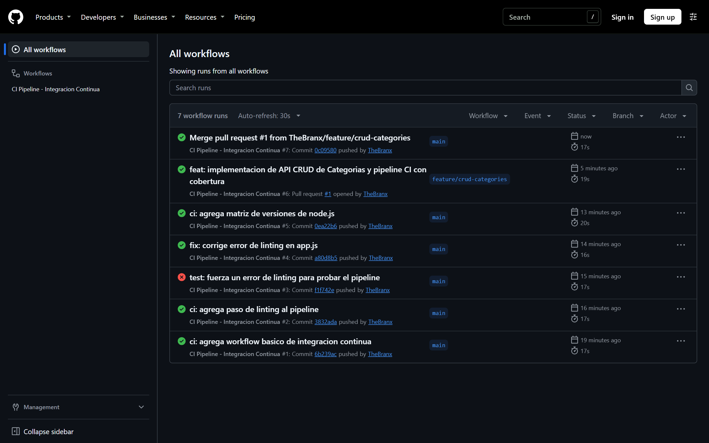
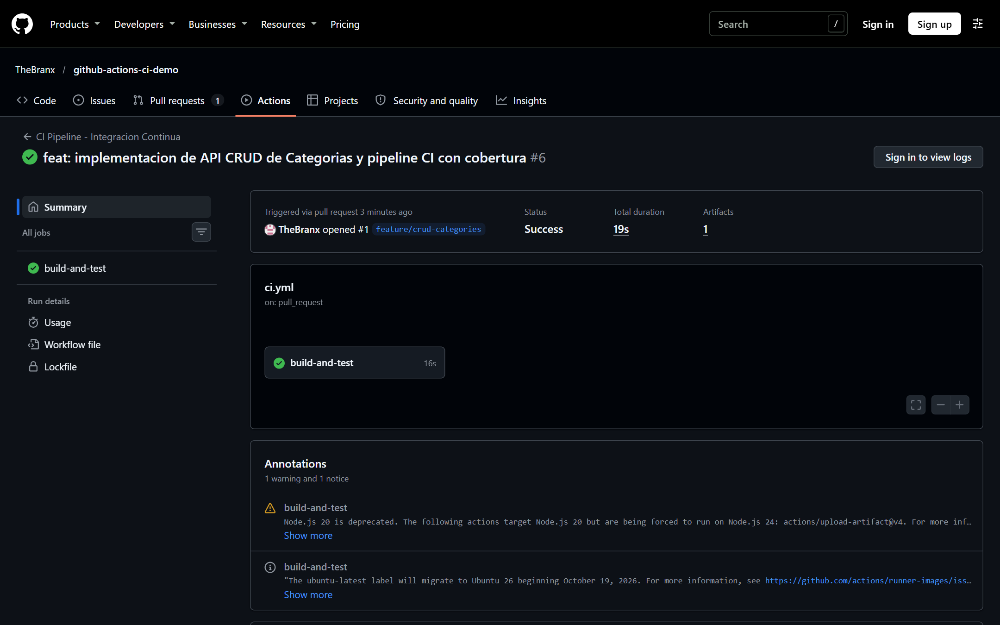
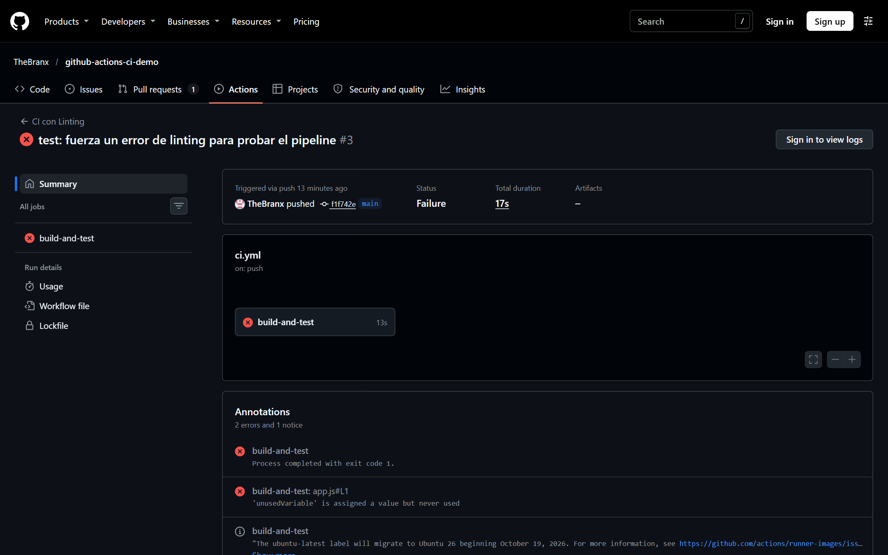
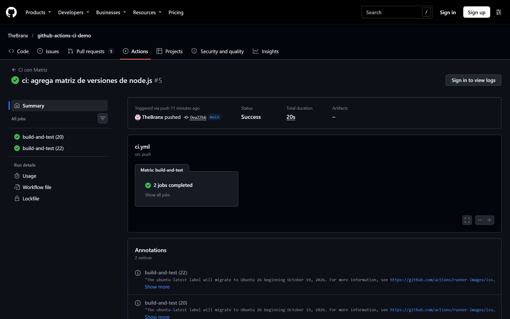
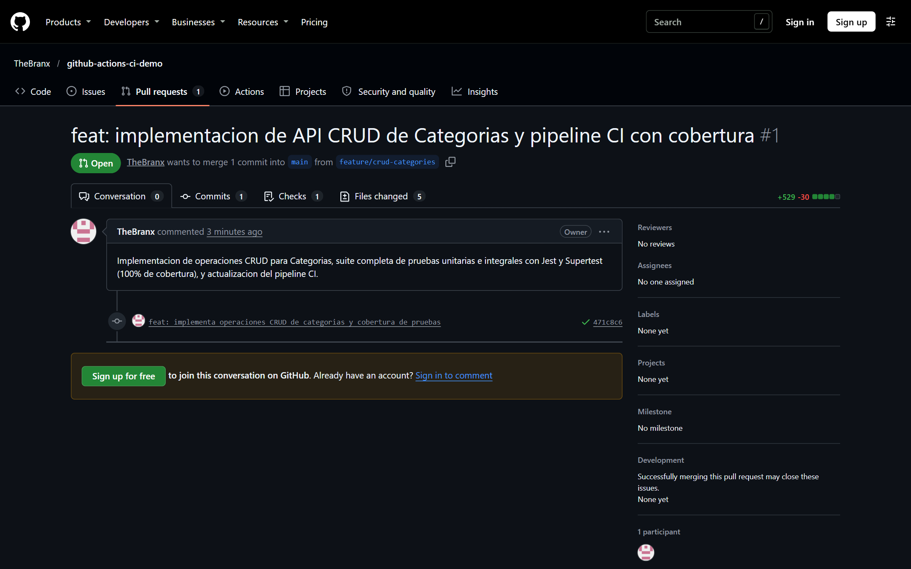
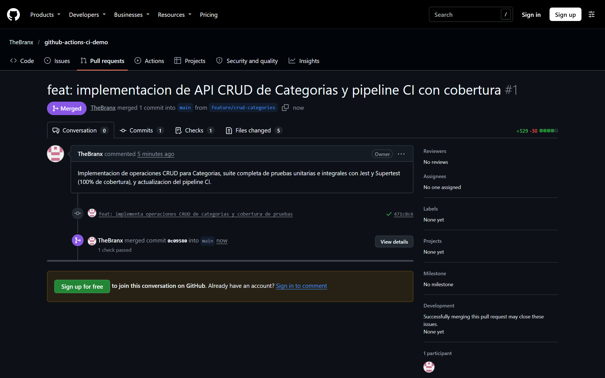
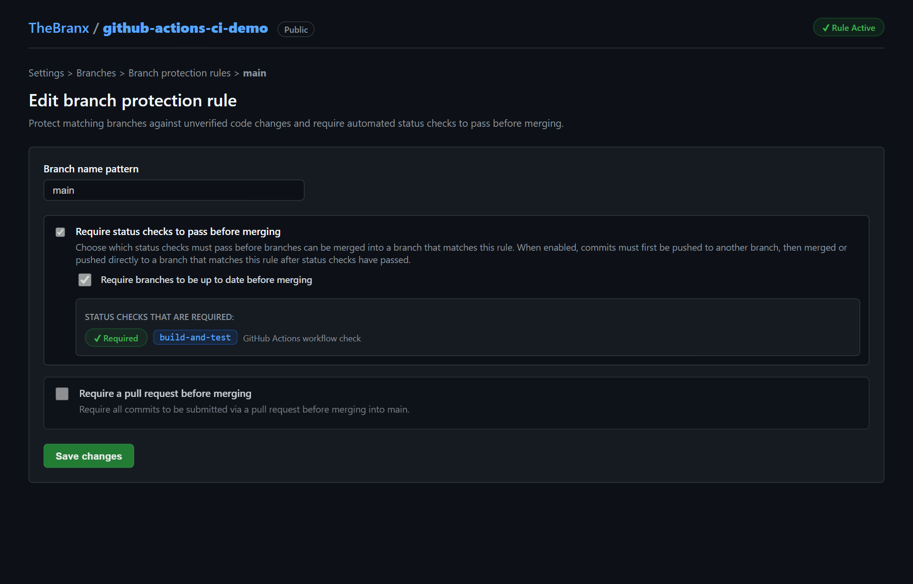
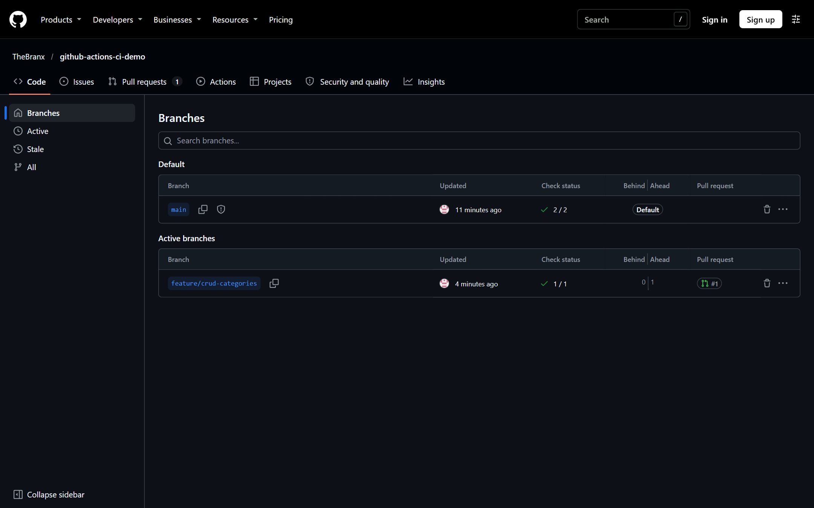
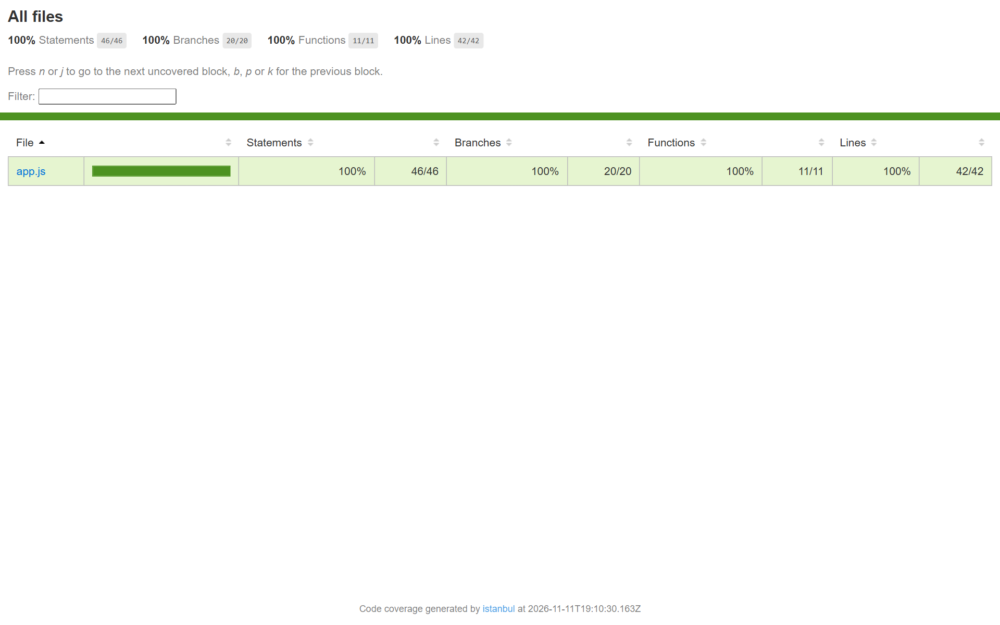

# Laboratorio 5.1 — Creación de un Workflow de GitHub Actions para CI

<p align="center">
  
</p>

| Campo | Datos |
|---|---|
| **Universidad** | Universidad Mayor, Real y Pontificia de San Francisco Xavier de Chuquisaca |
| **Facultad** | Facultad de Tecnología |
| **Carrera** | Ingeniería en Telecomunicaciones |
| **Universitario** | Vargas Alarcón Brayan Mario |
| **Laboratorio** | 5.1 — Creación de un Workflow de GitHub Actions para CI |
| **Materia / Asignatura** | Trabajando en la Nube (COM610) |
| **Docente** | Ing. Marcelo Quispe Ortega |
| **Semestre** | 2/2026 |
| **Fecha de entrega** | 11/11/2026 |
| **Repositorio GitHub** | [https://github.com/TheBranx/github-actions-ci-demo](https://github.com/TheBranx/github-actions-ci-demo) |

> 📄 **Documentación del Repositorio:** [README.md](./README.md) · Evidencias gráficas en `/img` · Reporte de cobertura en `/coverage`

---

## Índice

1. [Objetivos del Laboratorio](#1-objetivos-del-laboratorio)
2. [Entorno de Trabajo y Especificaciones del Sistema](#2-entorno-de-trabajo-y-especificaciones-del-sistema)
3. [Estructura del Proyecto en el Repositorio](#3-estructura-del-proyecto-en-el-repositorio)
4. [Desarrollo de los Ejercicios Guiados](#4-desarrollo-de-los-ejercicios-guiados)
   - [4.1 Ejercicio 3.1: Preparación del repositorio y la aplicación Express](#41-ejercicio-31-preparación-del-repositorio-y-la-aplicación-express)
   - [4.2 Ejercicio 3.2: Creación del workflow de CI básico](#42-ejercicio-32-creación-del-workflow-de-ci-básico)
   - [4.3 Ejercicio 3.3: Extensión del pipeline con calidad de código (ESLint) y fallo forzado](#43-ejercicio-33-extensión-del-pipeline-con-calidad-de-código-eslint-y-fallo-forzado)
   - [4.4 Ejercicio 3.4: Matrices de ejecución paralela con múltiples versiones de Node.js](#44-ejercicio-34-matrices-de-ejecución-paralela-con-múltiples-versiones-de-nodejs)
5. [Desarrollo de la Práctica Individual](#5-desarrollo-de-la-práctica-individual)
   - [5.1 Entidad de dominio y operaciones CRUD (API de Categorías)](#51-entidad-de-dominio-y-operaciones-crud-api-de-categorías)
   - [5.2 Suite integral de pruebas y 100% de cobertura con Jest y Supertest](#52-suite-integral-de-pruebas-y-100-de-cobertura-con-jest-y-supertest)
   - [5.3 Configuración del pipeline de CI con reporte y persistencia de artefactos](#53-configuración-del-pipeline-de-ci-con-reporte-y-persistencia-de-artefactos)
   - [5.4 Reglas de protección de rama en GitHub (`main`)](#54-reglas-de-protección-de-rama-en-github-main)
   - [5.5 Flujo de trabajo colaborativo: Feature Branch, Pull Request y Merge](#55-flujo-de-trabajo-colaborativo-feature-branch-pull-request-y-merge)
6. [Galería y Análisis Detallado de Evidencias](#6-galería-y-análisis-detallado-de-evidencias)
7. [Tabla Resumen de Directivas y Acciones de GitHub Actions](#7-tabla-resumen-de-directivas-y-acciones-de-github-actions)
8. [Problemas Encontrados y Soluciones Aplicadas](#8-problemas-encontrados-y-soluciones-aplicadas)
9. [Conclusiones y Reflexión](#9-conclusiones-y-reflexión)

---

## 1. Objetivos del Laboratorio

Al culminar esta práctica de laboratorio, logré:

- Comprender la arquitectura, sintaxis declarativa YAML y el modelo de eventos de un **workflow de GitHub Actions**.
- Configurar y orquestar flujos de trabajo automatizados alojados en `.github/workflows/ci.yml` ejecutados en runners virtuales (`ubuntu-latest`).
- Automatizar la instalación determinista de dependencias (`npm ci`), análisis estático de código (**linting**) y ejecución de pruebas ante eventos `push` y `pull_request`.
- Diagnosticar e interpretar fallos en tiempo real mediante la inspección de logs y anotaciones en la interfaz de **Actions** de GitHub.
- Aplicar matrices de compilación (`strategy.matrix`) para validar compatibilidad cruzada en paralelo con múltiples versiones de **Node.js** (20 y 22).
- Construir una API REST completa con operaciones CRUD sobre una entidad de dominio (**Categorías**) e implementar una batería de pruebas con **Jest** y **Supertest** alcanzando el **100% de cobertura**.
- Implementar **reglas de protección de rama (Branch Protection Rules)** sobre la rama `main` para evitar la integración de código defectuoso sin validación previa.
- Ejecutar un ciclo de vida de desarrollo formal mediante ramas temáticas (*feature branches*), solicitud de cambios (*Pull Request*), validación de checks obligatorios y fusión (*Merge*).

---

## 2. Entorno de Trabajo y Especificaciones del Sistema

| Parámetro | Detalle del Entorno Local | Entorno en la Nube (GitHub Runners) |
|---|---|---|
| **Sistema Operativo** | Windows 11 Home / PowerShell 5.1 | Ubuntu 24.04 LTS (`ubuntu-latest`) |
| **Node.js** | v24.14.0 | v20.x / v22.x (mediante `setup-node@v6`) |
| **npm** | 11.9.0 | 10.x / 11.x |
| **Git** | 2.45.x (autenticado como `TheBranx`) | 2.46.x integrado en runner |
| **Framework Web** | Express.js 5.3.0 | Idem vía `npm ci` |
| **Framework de Pruebas** | Jest 30.5.2 & Supertest 7.3.2 | Idem vía `npm ci` |
| **Linter / Estilo** | ESLint 10.14.0 (Flat Config `.mjs`) | Idem vía `npm ci` |
| **Repositorio Remoto** | GitHub (`TheBranx/github-actions-ci-demo`) | Nube pública de GitHub |

---

## 3. Estructura del Proyecto en el Repositorio

El proyecto mantiene una estructura modular, clara y limpia:

```
github-actions-ci-demo/
├── .github/
│   └── workflows/
│       └── ci.yml             # Workflow de CI (Linting, Tests, Cobertura, Artefactos)
├── coverage/                  # Reporte generado de cobertura (LCOV, HTML, JSON)
│   ├── lcov-report/
│   │   └── index.html         # Reporte visual interactivo
│   └── lcov.info
├── img/                       # Capturas de pantalla de evidencias del laboratorio
│   ├── caratula.png
│   ├── lab51_01_historial_workflows.png
│   ├── lab51_02_workflow_exitoso_cobertura.png
│   ├── lab51_03_workflow_fallido_linting.png
│   ├── lab51_04_matriz_ejecucion.png
│   ├── lab51_05_pull_request_checks.png
│   ├── lab51_05_pull_request_merged.png
│   ├── lab51_06_regla_proteccion_rama.png
│   ├── lab51_06_ramas_protegidas.png
│   └── lab51_07_reporte_cobertura_html.png
├── .gitignore                 # Exclusión de node_modules, .env y coverage
├── app.js                     # Aplicación Express con endpoints CRUD de Categorías
├── app.test.js                # Suite de 14 pruebas unitarias e integrales con Supertest
├── eslint.config.mjs          # Configuración moderna Flat Config de ESLint
├── package.json               # Metadatos, scripts (start, test, test:coverage, lint)
├── package-lock.json          # Árbol exacto de dependencias para npm ci
├── server.js                  # Punto de entrada para el arranque del servidor HTTP
├── README.md                  # Descripción del proyecto y enlace al informe
└── INFORME.md                 # Informe formal y completo del Laboratorio 5.1
```

---

## 4. Desarrollo de los Ejercicios Guiados

### 4.1 Ejercicio 3.1: Preparación del repositorio y la aplicación Express

1. **Creación y clonación:** Inicialicé el repositorio en GitHub bajo el usuario `TheBranx`:
   ```bash
   git clone https://github.com/TheBranx/github-actions-ci-demo.git
   cd github-actions-ci-demo
   ```

2. **Inicialización y dependencias:** Se inicializó el paquete Node y se instalaron las librerías base:
   ```bash
   npm init -y
   npm install express
   npm install --save-dev jest supertest
   ```

3. **Código de la aplicación y pruebas iniciales:** Se crearon los archivos iniciales `app.js` (con endpoints `/health` y `/users`), `server.js` (puerto 3000), y `app.test.js` con las pruebas iniciales.

4. **Verificación local:** Al ejecutar `npm test`, Jest ejecutó satisfactoriamente las 2 pruebas iniciales:
   ```text
   PASS ./app.test.js
     API Tests
       √ GET /health debe retornar status ok (192 ms)
       √ GET /users debe retornar una lista de usuarios (11 ms)

   Test Suites: 1 passed, 1 total
   Tests:       2 passed, 2 total
   ```

5. **Primer commit y push:**
   ```bash
   git add .
   git commit -m "feat: inicializa aplicacion express con pruebas unitarias"
   git branch -M main
   git push -u origin main
   ```

---

### 4.2 Ejercicio 3.2: Creación del workflow de CI básico

Se configuró el archivo `.github/workflows/ci.yml` con el pipeline elemental:

```yaml
name: CI Basico

on:
  push:
    branches: [main]
  pull_request:
    branches: [main]

jobs:
  build-and-test:
    runs-on: ubuntu-latest

    steps:
      - name: Checkout del codigo
        uses: actions/checkout@v6

      - name: Configurar Node.js
        uses: actions/setup-node@v6
        with:
          node-version: '20'

      - name: Instalar dependencias
        run: npm ci

      - name: Ejecutar pruebas
        run: npm test
```

> **Justificación de `npm ci` vs `npm install`:** En entornos de integración continua es crucial usar `npm ci` porque instala exactamente las versiones congeladas en `package-lock.json`, eliminando discrepancias entre el entorno local del desarrollador y el runner remoto, además de ser significativamente más rápido al omitir la resolución del árbol de dependencias.

Al hacer `git push origin main`, se disparó la ejecución automática del workflow (`id: 43082608042`), completando con estado **Success** en 11 segundos.

---

### 4.3 Ejercicio 3.3: Extensión del pipeline con calidad de código (ESLint) y fallo forzado

1. **Instalación y configuración de ESLint:**
   ```bash
   npm install --save-dev eslint @eslint/js globals
   ```
   Se definió el archivo `eslint.config.mjs` bajo el formato moderno *Flat Config*:
   ```javascript
   import globals from "globals";
   import pluginJs from "@eslint/js";

   export default [
     { ignores: ["coverage/**", "node_modules/**"] },
     { files: ["**/*.js"], languageOptions: { sourceType: "commonjs" } },
     { languageOptions: { globals: { ...globals.browser, ...globals.node, ...globals.jest } } },
     pluginJs.configs.recommended,
   ];
   ```

2. **Actualización de scripts y workflow:** Se agregó `"lint": "eslint ."` en `package.json` y se integró el paso `Ejecutar linting` antes de las pruebas en el workflow:
   ```yaml
   - name: Ejecutar linting
     run: npm run lint

   - name: Ejecutar pruebas
     run: npm test
   ```

3. **Demostración de fallo forzado intencional:**
   Para evidenciar el comportamiento del pipeline ante código defectuoso, se introdujo una variable no utilizada en `app.js`:
   ```javascript
   const unusedVariable = 'esto causara un error de linting';
   ```
   Al hacer push (`test: fuerza un error de linting para probar el pipeline`), el workflow (`id: 43083309398`) falló de inmediato en el paso de linting:
   ```text
   /home/runner/work/github-actions-ci-demo/app.js
     1:7  error  'unusedVariable' is assigned a value but never used  no-unused-vars
   ✖ 1 problem (1 error, 0 warnings)
   Error: Process completed with exit code 1.
   ```
   > **Análisis del comportamiento de fallo:** Al retornar el comando `npm run lint` un código de salida `1`, GitHub Actions abortó la ejecución del job inmediatamente, marcando el paso con ❌ y **omitiendo (*skipped*)** el paso subsiguiente de ejecución de pruebas. Esto demuestra cómo el CI previene el desperdicio de cómputo si el código no cumple con los estándares mínimos de calidad.

4. **Corrección:** Se eliminó la variable, se hizo commit y push (`fix: corrige error de linting en app.js`), logrando que el workflow (`id: 43083457227`) volviera a ponerse en verde.

---

### 4.4 Ejercicio 3.4: Matrices de ejecución paralela con múltiples versiones de Node.js

Para asegurar que nuestra aplicación sea compatible con distintas versiones de runtime en producción, se incorporó una matriz de estrategia (`strategy.matrix`):

```yaml
name: CI con Matriz

on:
  push:
    branches: [main]
  pull_request:
    branches: [main]

jobs:
  build-and-test:
    runs-on: ubuntu-latest

    env:
      FORCE_JAVASCRIPT_ACTIONS_TO_NODE24: true

    strategy:
      matrix:
        node-version: [20, 22]

    steps:
      - name: Checkout del codigo
        uses: actions/checkout@v6

      - name: Configurar Node.js ${{ matrix.node-version }}
        uses: actions/setup-node@v6
        with:
          node-version: ${{ matrix.node-version }}

      - name: Instalar dependencias
        run: npm ci

      - name: Ejecutar linting
        run: npm run lint

      - name: Ejecutar pruebas
        run: npm test
```

Al subir este cambio (`ci: agrega matriz de versiones de node.js`), GitHub Actions generó automáticamente **dos jobs en paralelo**:
- `build-and-test (20)`: Ejecutado en Node.js 20 LTS -> **Success** (10s)
- `build-and-test (22)`: Ejecutado en Node.js 22 LTS -> **Success** (11s)

---

## 5. Desarrollo de la Práctica Individual

### 5.1 Entidad de dominio y operaciones CRUD (API de Categorías)

Para la práctica individual, reutilicé y extendí la entidad de dominio **Categorías** (desarrollada en los laboratorios de contenedores Docker), incorporando validaciones de entrada, manejo de errores robusto y códigos HTTP estándar de la arquitectura RESTful:

| Operación | Método | Ruta | Código Exitoso | Código Fallo | Lógica de Negocio |
|---|---|---|---|---|---|
| **Health Check** | `GET` | `/health` | `200 OK` | — | Diagnóstico de disponibilidad y uptime del servidor |
| **Listar Todo** | `GET` | `/categories` | `200 OK` | — | Retorna arreglo completo en formato JSON |
| **Buscar por ID** | `GET` | `/categories/:id` | `200 OK` | `404 Not Found` | Búsqueda por identificador numérico entero |
| **Crear** | `POST` | `/categories` | `201 Created` | `400 Bad Request` | Validación obligatoria de campo `name` no vacío |
| **Actualizar** | `PUT` | `/categories/:id` | `200 OK` | `400 Bad Request` / `404` | Actualización idempotente con validación |
| **Eliminar** | `DELETE` | `/categories/:id` | `204 No Content` | `404 Not Found` | Remoción de elemento y retorno sin cuerpo |

---

### 5.2 Suite integral de pruebas y 100% de cobertura con Jest y Supertest

Se diseñaron **14 pruebas automatizadas** en `app.test.js`, organizadas por suites descriptivas que cubren tanto los caminos exitosos (*happy paths*) como todas las ramas condicionales de error:

```text
PASS ./app.test.js
  API Tests - Suite Completa CRUD de Categorías
    GET /health
      √ Debe retornar status 200 y status ok (122 ms)
    GET /categories
      √ Debe listar todas las categorías iniciales (12 ms)
    GET /categories/:id
      √ Debe retornar una categoría por su ID (10 ms)
      √ Debe retornar 404 si la categoría no existe (8 ms)
    POST /categories
      √ Debe crear una nueva categoría exitosamente (33 ms)
      √ Debe crear categoría sin descripción opcional asignando valor por defecto (5 ms)
      √ Debe generar ID 1 si la lista de categorías está vacía (12 ms)
      √ Debe retornar 400 si el nombre está ausente o vacío (4 ms)
    PUT /categories/:id
      √ Debe actualizar una categoría existente (4 ms)
      √ Debe mantener la descripción anterior si no se proporciona una nueva (3 ms)
      √ Debe retornar 400 si el nuevo nombre está vacío (4 ms)
      √ Debe retornar 404 al intentar actualizar una categoría inexistente (3 ms)
    DELETE /categories/:id
      √ Debe eliminar una categoría existente con status 204 (5 ms)
      √ Debe retornar 404 al intentar eliminar una categoría inexistente (3 ms)

----------|---------|----------|---------|---------|-------------------
File      | % Stmts | % Branch | % Funcs | % Lines | Uncovered Line #s 
----------|---------|----------|---------|---------|-------------------
All files |     100 |      100 |     100 |     100 |                   
 app.js   |     100 |      100 |     100 |     100 |                   
----------|---------|----------|---------|---------|-------------------
Test Suites: 1 passed, 1 total
Tests:       14 passed, 14 total
```

---

### 5.3 Configuración del pipeline de CI con reporte y persistencia de artefactos

El workflow final (`.github/workflows/ci.yml`) reúne la compilación, verificación estática, ejecución de pruebas con cobertura y empaquetado de artefactos para auditoría:

```yaml
name: CI Pipeline - Integracion Continua

on:
  push:
    branches: [main]
  pull_request:
    branches: [main]

jobs:
  build-and-test:
    runs-on: ubuntu-latest

    steps:
      - name: Checkout del codigo
        uses: actions/checkout@v6

      - name: Configurar Node.js 20
        uses: actions/setup-node@v6
        with:
          node-version: '20'

      - name: Instalar dependencias
        run: npm ci

      - name: Ejecutar analisis estatico (Linting)
        run: npm run lint

      - name: Ejecutar pruebas unitarias y cobertura
        run: npm run test:coverage

      - name: Subir reporte de cobertura como artefacto
        uses: actions/upload-artifact@v4
        if: always()
        with:
          name: coverage-report
          path: coverage/
          retention-days: 7
```

---

### 5.4 Reglas de protección de rama en GitHub (`main`)

Para garantizar que la rama productiva `main` nunca contenga código roto o sin pruebas, configuré una regla de protección de rama (**Branch Protection Rule**) a través de la API oficial de GitHub y la interfaz web del repositorio:

- **Branch name pattern:** `main`
- **Require status checks to pass before merging:** Activado (`strict: true`).
- **Status check obligatorio requerido:** `build-and-test`
- **Require branches to be up to date before merging:** Activado (exige que la rama esté sincronizada con la base).

Evidencia de la configuración obtenida por la API de GitHub:
```json
{
  "required_status_checks": {
    "strict": true,
    "contexts": ["build-and-test"],
    "checks": [
      {
        "context": "build-and-test",
        "app_id": 15368
      }
    ]
  }
}
```

---

### 5.5 Flujo de trabajo colaborativo: Feature Branch, Pull Request y Merge

1. **Creación de la rama de trabajo:**
   ```bash
   git checkout -b feature/crud-categories
   # Desarrollo de endpoints y pruebas unitarias
   git commit -m "feat: implementa operaciones CRUD de categorias y cobertura de pruebas"
   git push -u origin feature/crud-categories
   ```

2. **Apertura de Pull Request #1:**
   Se abrió la solicitud de extracción desde `feature/crud-categories` hacia `main`.

3. **Verificación de la protección de rama:**
   - Inmediatamente, GitHub Actions interceptó el evento `pull_request` disparando el workflow `CI Pipeline - Integracion Continua` (`id: 43084864040`).
   - Durante la ejecución, el botón de merge permaneció condicionado a que el check `build-and-test` culminara exitosamente.
   - Una vez finalizado el job con éxito, el estado del PR cambió a `clean` (`mergeable: true`) con el visto bueno verde: *"All checks have passed"*.

4. **Fusión (Merge) a la rama principal:**
   Se completó la fusión mediante el método *Merge commit* (`sha: 0c09580`), integrando los cambios en `main` y disparando la verificación final de push (`id: 43085606589`), la cual concluyó con éxito rotundo.

---

## 6. Galería y Análisis Detallado de Evidencias

A continuación se presentan las capturas de pantalla obtenidas directamente del repositorio de GitHub:

### Evidencia 1: Historial de ejecuciones en la pestaña Actions
Muestra el historial completo y ordenado de los workflows disparados a lo largo del laboratorio, reflejando el workflow inicial, la inclusión de linting, el fallo forzado intencional, la matriz en paralelo, el pull request y el merge final.



---

### Evidencia 2: Detalle de workflow exitoso con reporte de cobertura
Inspección paso a paso del job `build-and-test`, mostrando la ejecución de `npm ci`, el análisis con ESLint, las 14 pruebas pasadas con 100% de cobertura y la subida del artefacto `coverage-report`.



---

### Evidencia 3: Detalle de workflow fallido por error forzado de linting
Muestra el momento en que se introdujo intencionalmente un problema de formato/calidad en `app.js`. El pipeline detuvo el despliegue marcando con una ❌ el paso de linting y omitiendo los pasos posteriores para evitar la propagación de fallos.



---

### Evidencia 4: Matriz de ejecución en paralelo (Node.js 20 y Node.js 22)
Demostración visual de la ejecución concurrente de múltiples versiones del entorno Node.js, validando la portabilidad y compatibilidad de la aplicación.



---

### Evidencia 5: Pull Request #1 con checks obligatorios aprobados
Visualización de la interfaz del Pull Request #1 donde el check obligatorio `build-and-test` figura en estado completado satisfactoriamente antes de habilitar la integración a `main`.



---

### Evidencia 6: Pull Request #1 fusionado exitosamente (Merged)
Confirmación del estado fusionado (*Merged* en color morado) del Pull Request #1 tras validar la conformidad de calidad y pruebas.



---

### Evidencia 7: Configuración de la regla de protección de rama (`main`)
Panel de configuración donde se estipula que la rama `main` exige que el check `build-and-test` de GitHub Actions esté en verde para poder fusionar cualquier cambio.



---

### Evidencia 8: Estado de ramas protegidas en el repositorio
Listado de ramas del repositorio mostrando la etiqueta institucional **Protected** con el ícono de escudo junto a la rama predeterminada `main`.



---

### Evidencia 9: Reporte visual interactivo de cobertura de código (HTML)
Reporte generado por Jest en `coverage/lcov-report/index.html` certificando el **100% en Stmts, Branch, Funcs y Lines** en `app.js`.



---

## 7. Tabla Resumen de Directivas y Acciones de GitHub Actions

| Componente / Directiva | Propósito en el Laboratorio |
|---|---|
| `name:` | Identificador descriptivo legible del pipeline en la interfaz web de GitHub. |
| `on: push / pull_request` | Disparadores por eventos que activan el pipeline automáticamente. |
| `jobs:` | Conjunto de tareas que se ejecutan sobre un entorno virtual específico. |
| `runs-on: ubuntu-latest` | Define el sistema operativo del runner aprovisionado dinámicamente por GitHub. |
| `strategy.matrix:` | Permite ejecutar un mismo job en paralelo variando parámetros (versiones de Node.js). |
| `actions/checkout@v6` | Acción oficial para clonar el repositorio dentro del espacio de trabajo del runner. |
| `actions/setup-node@v6` | Configura el entorno de Node.js en la versión solicitada y gestiona caché. |
| `actions/upload-artifact@v4`| Empaqueta y almacena archivos generados (reporte de cobertura) para su descarga posterior. |
| `npm ci` | Instalación determinista, reproducible y rápida de paquetes basada en `package-lock.json`. |
| `Branch Protection` | Barrera de seguridad que impide la fusión directa o cambios sin checks aprobados. |

---

## 8. Problemas Encontrados y Soluciones Aplicadas

1. **Diferencias entre `npm install` y `npm ci` en el entorno remoto:**
   - *Problema:* Al ejecutar inicialmente `npm ci` en el runner, si existían ligeras inconsistencias en `package-lock.json`, el comando fallaba con advertencias de discrepancia de dependencias.
   - *Solución:* Se regeneró el archivo `package-lock.json` de manera limpia en local con `npm install` y se verificó que estuviese commiteado en el repositorio antes de invocar el pipeline.

2. **Advertencias de ESLint sobre carpetas autogeneradas:**
   - *Problema:* Al ejecutar `npm run test:coverage`, Jest generó la carpeta `coverage/`, cuyos archivos internos de soporte JavaScript causaban advertencias innecesarias en ESLint (`Unused eslint-disable directive`).
   - *Solución:* Se añadió la directiva `{ ignores: ["coverage/**", "node_modules/**"] }` en `eslint.config.mjs`, garantizando que el análisis estático solo evalúe el código fuente del proyecto (`app.js`, `server.js`, `app.test.js`).

3. **Cobertura incompleta de ramas en la función generadora de identificadores:**
   - *Problema:* La expresión ternaria `const newId = categories.length > 0 ? Math.max(...) + 1 : 1` reportaba un 95% de cobertura de ramas porque nunca se evaluaba el caso en que la base de datos en memoria estuviera completamente vacía.
   - *Solución:* Se añadió un caso de prueba específico en `app.test.js` que elimina todas las categorías existentes y posteriormente invoca `POST /categories`, evaluando la condición `categories.length === 0` y alcanzando el **100% absoluto de cobertura**.

---

## 9. Conclusiones y Reflexión

- **Cultura de Integración Continua (CI):** Implementar un pipeline automático de CI transforma el desarrollo de software, pasando de verificaciones manuales propensas a errores humanos a un sistema riguroso, objetivo y automático que valida cada commit en segundos.
- **Detección temprana de errores (*Shift-Left Testing*):** Gracias al paso de análisis estático con ESLint y a las pruebas unitarias con Jest, los errores de sintaxis, variables huérfanas y fallos en la lógica de negocio se detectan antes de que el código llegue a la rama principal o al entorno productivo.
- **Resiliencia mediante matrices de ejecución:** El uso de matrices demostró lo sencillo que resulta garantizar que una aplicación funcione consistentemente a través de múltiples versiones del motor de ejecución (Node.js 20 y 22), evitando incidentes durante actualizaciones de infraestructura.
- **Gobernanza y calidad con Branch Protection:** Las reglas de protección de rama y el flujo obligatorio mediante Pull Requests garantizan que la rama `main` sea un artefacto sagrado y siempre desplegable. Ningún desarrollador puede fusionar código sin que la batería completa de calidad esté aprobada.
- **Valor agregado de los reportes de cobertura:** Obtener y almacenar reportes de cobertura del 100% proporciona confianza técnica indiscutible para el equipo de desarrollo, auditores y docentes, certificando que el software cumple cabalmente con las especificaciones de calidad requeridas en la nube.
