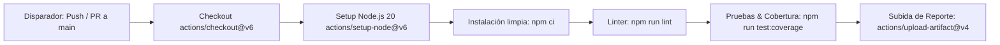

# GitHub Actions CI Demo - API CRUD de Categorías 🚀

[](https://github.com/TheBranx/github-actions-ci-demo/actions/workflows/ci.yml)
[](https://nodejs.org/)
[](./INFORME.md)
[](LICENSE)

Repositorio desarrollado para el **Laboratorio 5.1: Creación de un Workflow de GitHub Actions para CI** en la materia **Trabajando en la Nube (COM610)** de la **Universidad Mayor, Real y Pontificia de San Francisco Xavier de Chuquisaca (USFX)**.

Contiene una API RESTful desarrollada con **Express.js**, una completa suite de pruebas unitarias e integrales con **Jest** y **Supertest** (alcanzando el **100% de cobertura de código**), análisis estático con **ESLint**, un pipeline de **Integración Continua (CI)** con **GitHub Actions**, reglas de **protección de rama (`main`)** y un flujo de trabajo basado en **Pull Requests**.

---

## 📑 Documentación y Entrega del Laboratorio

Todo el procedimiento técnico, comandos ejecutados, justificaciones, análisis de incidencias y capturas de pantalla de evidencias se encuentran detallados en el informe formal del laboratorio:

👉 **[Ver Informe Completo del Laboratorio (INFORME.md)](./INFORME.md)**

---

## 🛠️ Stack Tecnológico

- **Lenguaje:** JavaScript (Node.js 20+ / CommonJS)
- **Framework Web:** Express.js 5.x
- **Testing & Assertions:** Jest 30.x + Supertest 7.x
- **Linter & Análisis Estático:** ESLint 10.x con Flat Config (`eslint.config.mjs`)
- **CI/CD Platform:** GitHub Actions (`ubuntu-latest`)
- **Gestor de Dependencias:** npm

---

## 🚀 Inicio Rápido Local

### 1. Clonar el repositorio
```bash
git clone https://github.com/TheBranx/github-actions-ci-demo.git
cd github-actions-ci-demo
```

### 2. Instalar dependencias
```bash
npm install
# o en entornos de CI estricto:
npm ci
```

### 3. Ejecutar análisis estático (Linting)
```bash
npm run lint
```

### 4. Ejecutar pruebas unitarias y reporte de cobertura
```bash
npm test
npm run test:coverage
```

### 5. Iniciar el servidor local
```bash
npm start
```
El servidor escuchará en el puerto `3000` (http://localhost:3000).

---

## 📡 Endpoints de la API REST

| Método | Endpoint | Descripción | Códigos HTTP |
|---|---|---|---|
| `GET` | `/health` | Chequeo de salud del servicio (uptime y status) | `200 OK` |
| `GET` | `/categories` | Listado completo de categorías | `200 OK` |
| `GET` | `/categories/:id` | Búsqueda de categoría por ID | `200 OK`, `404 Not Found` |
| `POST` | `/categories` | Creación de nueva categoría | `201 Created`, `400 Bad Request` |
| `PUT` | `/categories/:id` | Actualización de categoría existente | `200 OK`, `400 Bad Request`, `404 Not Found` |
| `DELETE` | `/categories/:id` | Eliminación de categoría por ID | `204 No Content`, `404 Not Found` |

---

## ⚙️ Estructura del Pipeline CI (`.github/workflows/ci.yml`)

El pipeline se activa automáticamente ante eventos `push` o `pull_request` dirigidos a la rama `main`:



---

## 👤 Autor

- **Universitario:** Vargas Alarcón Brayan Mario
- **Carrera:** Ingeniería en Telecomunicaciones
- **Materia:** Trabajando en la Nube (COM610)
- **Docente:** Ing. Marcelo Quispe Ortega
- **Institución:** Universidad Mayor, Real y Pontificia de San Francisco Xavier de Chuquisaca (USFX)
